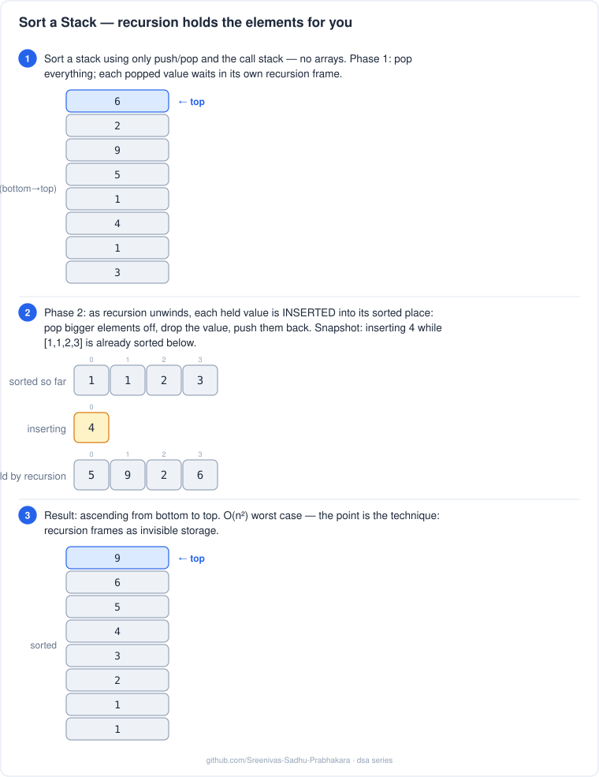

# Sort a Stack (Recursion)

> Striver SDE Sheet 081 · Day 13 Stack & Queue — pop everything on the call stack, then re-insert each element into sorted position, still using only stack moves. Go, stdlib only, tested.

## Problem

Sort a stack using only its own operations — push, pop, top — plus recursion. No auxiliary array, no index arithmetic: the recursion *is* the extra storage.

## Approach

Two mutually simple recursions. `SortStack` pops the top, sorts the remainder, and hands the popped value to `insertSorted`, which pops while the top is larger, drops the value in, and pushes everything back on unwind. The call stack holds what an explicit temporary stack would — that's the trick being taught: recursion as a legal second stack. Insertion into sorted position mirrors insertion sort, hence the quadratic bound.

**Complexity:** O(n²) time, O(n) recursion depth.

## Visual walkthrough

Read the picture top to bottom — each numbered frame is one moment of the algorithm
running on this repo's test example.

## Run

    go test ./...   # verify
    go run .        # demo

---

One of 191 repos solving Striver's SDE Sheet in Go — stdlib only, one problem per repo, every solution tested. Browse the set: [`dsa-*` repos](https://github.com/Sreenivas-Sadhu-Prabhakara?tab=repositories&q=dsa-&type=source).
